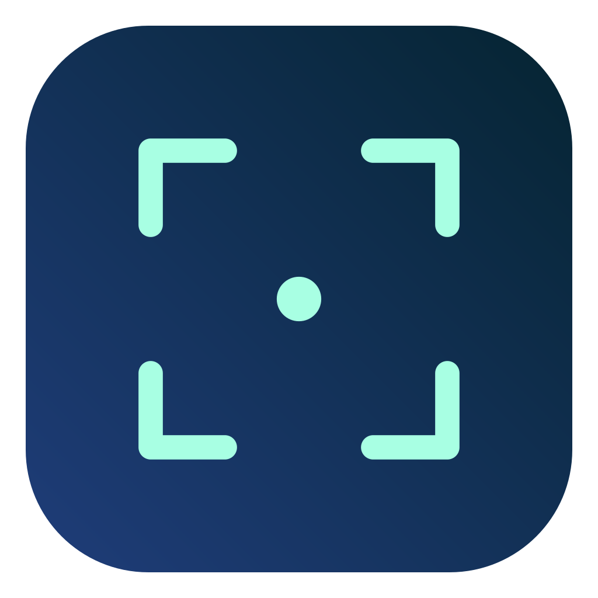
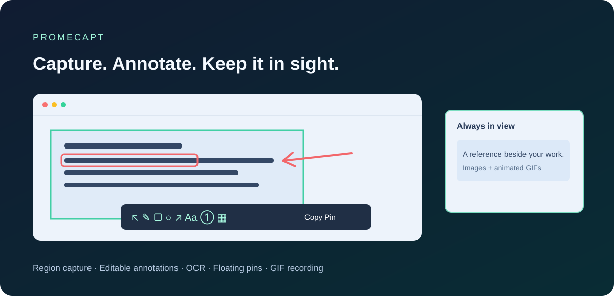

<div align="center">
  
  <h1>Promecapt</h1>
  <p><strong>撮る。その場で書き込む。いつでも見える場所に。</strong></p>
  <p>macOS向けの画面キャプチャ・注釈・ピン留め・GIF録画アプリ</p>
  <p><a href="README.md">English</a> · <a href="README.ko.md">한국어</a> · <a href="README.ja.md">日本語</a> · <a href="README.zh-CN.md">简体中文</a></p>
  <p><a href="https://github.com/PROMLEE/promecapt/releases">ダウンロード</a> · <a href="https://github.com/PROMLEE/promecapt/issues">問題を報告</a></p>
  <p>macOS 13以降 · Apple Silicon / Intel · MITライセンス · v1.0.0</p>
</div>



## 主な機能

- **画面上でそのまま編集：** ウィンドウやアクセシビリティ要素を検出。範囲をドラッグして選び、8つのハンドルやキーで調整できます。
- **後から変更できる注釈：** ペン、蛍光ペン、図形、矢印、テキスト、番号。選択ツールで移動・サイズ・色・太さを変更します。
- **1つのツールで隠す：** モザイク・ぼかし・黒塗り。ホイールと数値入力で太さや強さを調整します。
- **画像とGIFのピン留め：** 常に手前に表示し、拡大縮小・透明度・グループ・クリック透過に対応。再起動後も復元され、GIFはアニメーションを維持します。
- **範囲OCR：** 読みたい文字だけをドラッグし、結果を確認・修正してコピー。現在の認識言語は韓国語と英語です。
- **キャプチャ履歴：** `,` / `.`で履歴を移動し、周囲の画面も復元します。
- **GIF録画：** 範囲表示、フレーム数・解像度・時間の設定、録画後の再生確認・コピー・ピン留め・保存。
- **4言語のUI：** 韓国語・英語・日本語・簡体字中国語。システム言語による自動選択と手動設定が可能です。

## インストール

[Releases](https://github.com/PROMLEE/promecapt/releases)から、Apple Siliconは **arm64**、Intelは **x86_64** のZIPをダウンロードします。展開して **Promecapt.app** をアプリケーションフォルダに移し、起動してください。メニューバーにキャプチャ枠のアイコンが表示されます。

**署名について：** 初回配布はad-hoc署名です。Apple Developer ID署名・公証はまだありません。macOSが起動をブロックする場合があります。ソースを確認して自分でビルドするか、信頼するアプリについて[Appleの案内](https://support.apple.com/102445)に従ってください。システム全体の保護を無効にする必要はありません。

最初のキャプチャ前に、**システム設定 → プライバシーとセキュリティ → 画面収録**（新しいmacOSでは **画面とシステムオーディオの収録**）でPromecaptを許可し、アプリを再起動します。アプリ内部の要素検出と安定したグローバルキー処理にはアクセシビリティ権限を使います。音声は録音しません。

## 基本操作

| 操作 | 初期設定のキー・ジェスチャー |
| --- | --- |
| 範囲・ウィンドウをキャプチャ | `⌥⌘1` → ドラッグ、または検出対象をクリック |
| キャプチャをコピー / ピン留め | `⌘C` / `⌘Enter` |
| クリップボードをピン留め | `⌥⌘3` |
| すべてのピンを表示・非表示 | `⌥⌘4` |
| 前・次の履歴 | キャプチャ中に `,` / `.` |
| キャプチャ取消 / ピンを閉じる | `Esc` |
| 設定 | メニューバーのアイコン → 設定、またはアプリ使用中に `⌘,` |
| 太さ・ぼかしの強さ | 画像上のホイール、または数値入力と上下ボタン |
| ピンの移動 / 拡大縮小 | ドラッグ / ホイール |
| 透明度 | `Ctrl` + ホイール |
| 静止画像のピンをその場で編集 | `Space`。既存の注釈は選択ツールで変更 |
| GIF録画 | メニューの範囲録画、またはキャプチャツールバーのGIFボタン |

設定 → ショートカットで **F1 / F3 / F4** プリセットや独自の組み合わせを指定できます。明るさ・音量キーモードでは `Fn+F1` を使用するか、macOSで標準のファンクションキーを有効にしてください。`Enter` は文字入力の確定に使い、キャプチャを終了しません。設定 → 一般で言語とDock表示を変更できます。

## GIFの設定と出力

設定 → GIFで **5～30fps**、**長辺640・1280・1920pxまたは元のRetinaピクセル数**、**最長15・30・60秒**、ポインタの録画を設定できます。元の解像度より拡大しません。静止画面では実際のフレーム数が減る場合があります。一時フレームが256MiBに達しても録画を終了します。

赤い点線と範囲外の薄い陰影で録画範囲を示し、クリックを妨げません。停止後は結果ウィンドウで再生を確認し、**コピー・ピン留め・保存**を選びます。コピーにはGIF本体、添付用ファイルパス、代替PNGが含まれます。貼り付け先でのアニメーション表示は、そのアプリのGIF対応によります。1つの画面内を録画し、Promecaptのウィンドウと音声は含みません。GIFへの注釈、回転、フレーム編集は未対応です。

## プライバシーと保存

画像とOCRはこのMacで処理します。アカウント、アップロードサービス、分析収集機能はありません。

履歴には選択画像だけでなく、**当時の画面全体と選択位置**もローカル保存します。機密情報を含む画面では、この点にご注意ください。件数制限と履歴の消去では背景も削除し、ピン留め画像は別に保持します。旧バージョンの切り抜き画像には元の画面がないため、現在のキャプチャの背景を使います。

既存のPromepaste設定とライブラリは維持します。互換性のため、バンドルIDは `com.promlee.promepaste`、保存場所は `~/Library/Application Support/Promepaste` のままです。コピーしたGIFの添付ファイルはローカルにキャッシュし、新しいコピー時に古いものを整理します。

## ソースからビルド

macOS 13以降、Swift 5.9以降、Xcode Command Line Toolsが必要です。`swift test`にはXcode全体が必要です。外部Swiftパッケージへの依存はありません。

```sh
git clone https://github.com/PROMLEE/promecapt.git
cd promecapt
bash scripts/test-local.sh
bash scripts/package.sh
open dist/Promecapt.app
```

CIはApple SiliconとIntelでXCTestを実行します。`ARCH=arm64` / `ARCH=x86_64`でパッケージの対象を指定できます。[検証](docs/QA.md)、[配布手順](docs/RELEASING.md)、[変更履歴](CHANGELOG.md)、[貢献ガイド](CONTRIBUTING.md)も参照してください。

**1.0.0には自動更新機能はありません。** Developer ID署名・公証と署名付き更新を計画しており、[更新設計](docs/AUTO-UPDATE.md)を公開しています。

## ライセンス

[MIT](LICENSE)。条件に従い、個人・商用利用、変更、再配布が可能です。Snipasteとは関係のない独立プロジェクトで、同製品のソース、バイナリ、視覚素材は配布しません。アプリとメニューバーのアイコンは、共通の独自キャプチャ枠マークから生成します。
