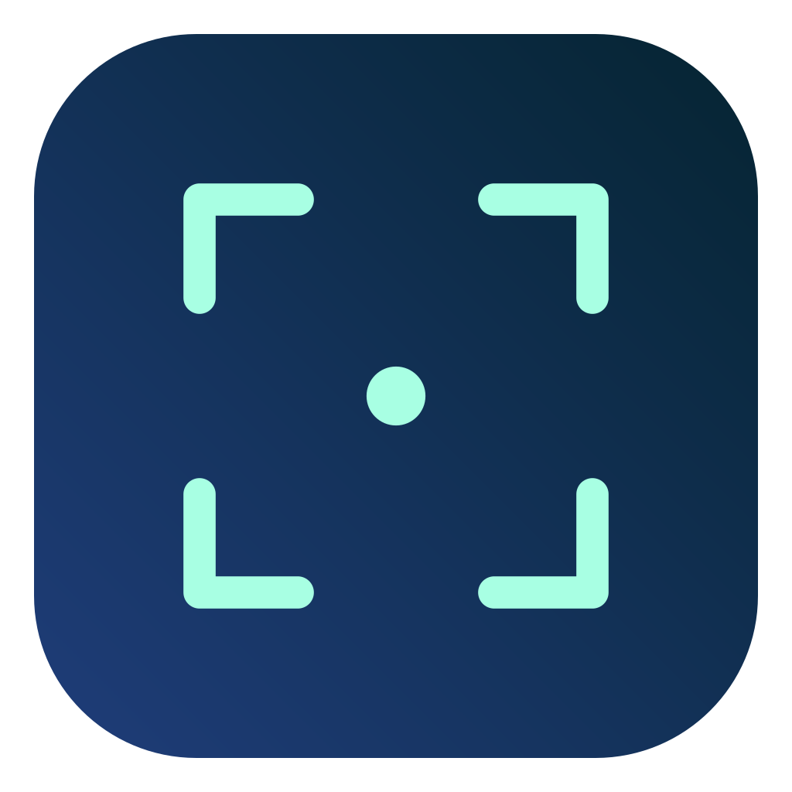
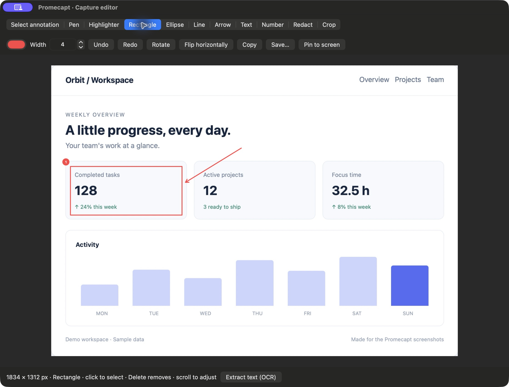
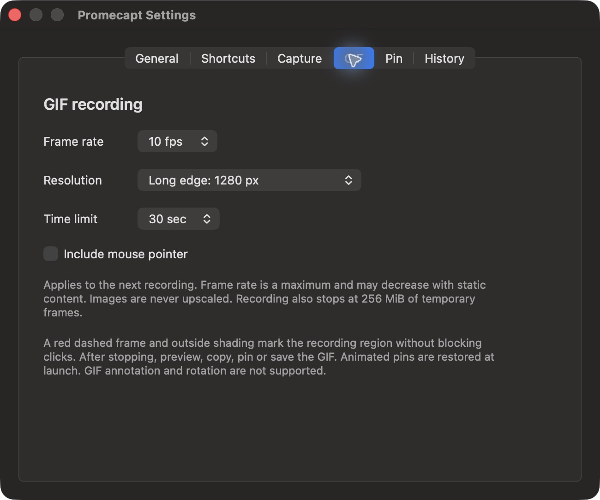

<div align="center">
  
  <h1>Promecapt</h1>
  <p><strong>캡처하고, 편집하고, 곁에 고정하세요.</strong></p>
  <p>상용 캡처 도구의 오픈소스 대안. macOS 캡처·주석·화면 고정·GIF 녹화.</p>
  <p><a href="https://github.com/PROMLEE/promecapt/releases/latest">다운로드</a> · <a href="docs/INSTALL.ko.md">설치 가이드</a> · <a href="https://github.com/PROMLEE/promecapt/issues">Issues</a></p>
  <p>macOS 13+ · Apple Silicon & Intel · MIT</p>
  <p><a href="README.md">English</a> · <a href="README.ko.md">한국어</a> · <a href="README.ja.md">日本語</a> · <a href="README.zh-CN.md">简体中文</a></p>
</div>



<p align="center"><sub>실제 앱 화면 · 샘플 데이터 · 영어 UI</sub></p>

## 주요 기능

| 기능 | 지원 내용 |
| --- | --- |
| **캡처** | 영역·창·앱 내부 요소 자동 감지 |
| **주석** | 펜·도형·화살표·글자·번호, 다시 선택해 수정 |
| **가리기** | 모자이크·블러·불투명 블랙박스 |
| **화면 고정** | 이미지·움직이는 GIF, 확대·투명도·그룹 |
| **OCR** | 필요한 영역만 지정해 한국어·영어 인식 |
| **GIF** | 5~30fps, 해상도·시간 설정, 미리보기·복사·고정·저장 |

UI: 한국어 · English · 日本語 · 简体中文. [기능 제한](docs/FEATURES.md) · 1.1.0부터 [수동·선택적 자동 업데이트](docs/AUTO-UPDATE.md) 지원. 1.0.0 사용자는 한 번 직접 설치하세요.

<details>
<summary>GIF 설정</summary>



</details>

## 설치

1. [Releases](https://github.com/PROMLEE/promecapt/releases/latest)에서 **Apple Silicon(arm64)** 또는 **Intel(x86_64)** DMG를 받습니다.
2. DMG를 열고 **Promecapt.app**을 **Applications** 폴더로 드래그한 뒤 디스크를 추출합니다.
3. 실행 후 **화면 녹화**와 **손쉬운 사용** 권한을 허용합니다.

**현재 Apple 공증은 없습니다.** macOS가 신뢰하는 다운로드 앱을 차단하면 [설치 가이드](docs/INSTALL.ko.md)를 참고하세요. 직접 빌드에는 유료 개발자 계정이 필요 없습니다.

## 단축키

| 동작 | 단축키 |
| --- | --- |
| 캡처 | `⌥⌘1` |
| 캡처 복사 / 고정 | `⌘C` / `⌘Enter` |
| 클립보드 고정 | `⌥⌘3` |
| 고정 이미지 표시 / 숨기기 | `⌥⌘4` |
| 이전 / 다음 캡처 | `,` / `.` |
| 취소 / 고정 창 닫기 | `Esc` |

설정 → 단축키에서 F1 등으로 변경할 수 있습니다. 미디어 키 모드에서는 `Fn+F1`을 사용하세요.

## 직접 빌드

무료 Apple Command Line Tools와 Swift 5.9 이상이 필요합니다. 유료 개발자 계정·인증서는 필요 없습니다.

```sh
xcode-select --install # complete the installer before continuing
git clone --branch v1.1.7 --depth 1 https://github.com/PROMLEE/promecapt.git
cd promecapt
bash scripts/package.sh
mkdir -p "$HOME/Applications"
ditto dist/Promecapt.app "$HOME/Applications/Promecapt.app"
open "$HOME/Applications/Promecapt.app"
```

## 문서

[설치 가이드](docs/INSTALL.ko.md) · [사용법](docs/USAGE.md) · [기여 안내](CONTRIBUTING.md) · [Changelog](CHANGELOG.md) · [llms.txt](llms.txt)

이미지·OCR은 로컬에서 처리하며 업로드·분석 수집이 없습니다. 기록에는 전체 화면도 저장됩니다. [보관·개인정보 안내](docs/USAGE.md#privacy--storage).

[MIT](LICENSE) — 개인·상업적 사용 가능.
