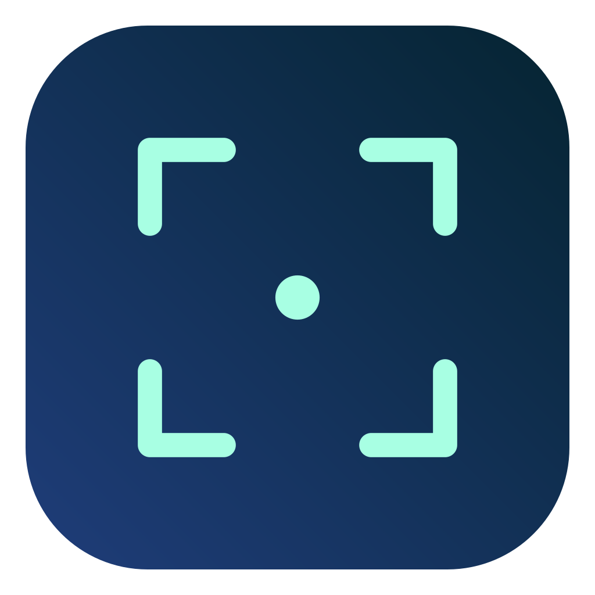
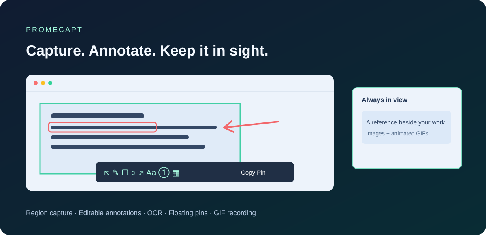

<div align="center">
  
  <h1>Promecapt</h1>
  <p><strong>Capture. Annotate. Keep it in sight.</strong></p>
  <p>An open-source alternative to proprietary screenshot tools for macOS. Capture, annotate, pin and record GIFs.</p>
  <p><a href="README.md">English</a> · <a href="README.ko.md">한국어</a> · <a href="README.ja.md">日本語</a> · <a href="README.zh-CN.md">简体中文</a></p>
  <p><a href="https://github.com/PROMLEE/promecapt/releases">Download</a> · <a href="#quick-start">Quick start</a> · <a href="https://github.com/PROMLEE/promecapt/issues">Report an issue</a></p>
  <p>macOS 13+ · Apple Silicon & Intel · MIT License · v1.0.0</p>
</div>



## Why Promecapt?

Select a window or region, annotate it without leaving the screen, and pin the result above your other apps. Keep a reference nearby, extract text from a small area, or record a short GIF—all from the menu bar.

- **Capture in place.** Automatic window and accessible element detection, eight resize handles, and keyboard adjustments.
- **Editable annotations.** Pen, highlighter, shapes, arrows, text and numbered badges. Select an annotation later to move, resize or restyle it.
- **Redact in one tool.** Mosaic, blur and black box, with scroll-wheel width or strength controls.
- **Pin images and GIFs.** Floating, resizable references with zoom, opacity, groups, click-through and restoration after relaunch. GIF pins keep playing.
- **Region OCR.** Drag only the text you want to recognize; review and copy the result. Current OCR languages: Korean and English.
- **Capture history.** `,` and `.` move through captures and restore their surrounding screen context.
- **GIF recording.** Visible recording region; configurable frame rate, resolution, duration and pointer. Preview, copy, pin or save when finished.
- **Four UI languages.** Korean, English, Japanese and Simplified Chinese, with system language detection and a manual setting.

## Install

**An Apple Developer account is not required to build and run Promecapt on another Mac.** Choose one of these paths:

1. **Build locally with free Apple tools.** Install Command Line Tools, clone the release source, run `bash scripts/package.sh`, and launch the generated `.app`. Follow the complete [local installation guide](docs/INSTALL.md) or the commands below.
2. **Download a prebuilt ZIP** from [Releases](https://github.com/PROMLEE/promecapt/releases): **arm64** for Apple Silicon or **x86_64** for Intel. Unzip and move **Promecapt.app** to Applications.

The current ZIPs are ad-hoc signed, **not Developer ID signed or Apple-notarized**. This affects macOS's first-open verification, not whether the app is limited to one computer. If a trusted download is blocked, follow [Apple's per-app opening instructions](https://support.apple.com/en-us/102445) and the [installation troubleshooting guide](docs/INSTALL.md#option-b--use-a-prebuilt-release). Organization-managed Macs can impose additional restrictions.

Allow Promecapt in **System Settings → Privacy & Security → Screen Recording** (called **Screen & System Audio Recording** on newer macOS), then relaunch if requested. Accessibility enables app-element detection and enhanced global shortcuts. Audio is not recorded. Look for the capture-frame icon in the menu bar.

## Quick start

| Action | Default shortcut / gesture |
| --- | --- |
| Capture a region or window | `⌥⌘1`, then drag or click an automatically detected target |
| Copy capture / pin capture | `⌘C` / `⌘Enter` |
| Pin clipboard | `⌥⌘3` |
| Show / hide all pins | `⌥⌘4` |
| Browse older / newer captures | `,` / `.` during capture |
| Cancel capture / close a pin | `Esc` |
| Open settings | Menu bar icon → Settings, or `⌘,` while the app is active |
| Change stroke width / redaction strength | Scroll over the image, or use the numeric stepper |
| Move / zoom a pin | Drag / scroll |
| Change pin opacity | `Ctrl` + scroll |
| Edit a still-image pin in place | `Space`; use the selection tool to edit existing annotations |
| Record a GIF | Menu bar → Record GIF region, or the capture toolbar's GIF button |

Choose the **F1 / F3 / F4** preset or your own shortcuts in Settings → Shortcuts. In media-key mode, use `Fn+F1` or enable standard function keys in macOS. `Enter` confirms text; it does not finish a capture.

Settings → General selects your language and Dock visibility. Menu bar operation works with the Dock icon hidden.

## GIF recording

Settings → GIF offers **5–30 fps**, a **640 / 1280 / 1920 px long edge or original Retina pixels**, and **15 / 30 / 60 second** limits. The app never upscales the source. Static screens may produce fewer frames; recording also stops at 256 MiB of temporary frame files.

A red dashed border and light outside shading mark the recording region without blocking clicks. After stopping, the result window provides playback, **Copy**, **Pin** and **Save**. Copy includes original GIF data, a GIF attachment path and a PNG fallback; animation when pasted depends on the receiving app. Recording stays within one display, excludes Promecapt windows, and captures no audio. GIF annotation, rotation and frame editing are not supported yet.

## Privacy & storage

Capture, annotation and OCR processing happen locally. There is no account, upload service or analytics in the app.

History stores the selected image **and the full display snapshot with its selection position**, so browsing can restore the surrounding screen. Keep this in mind when capturing private material. The history limit and Clear History remove these backgrounds too; pins are stored separately.

Your preferences and library remain on this Mac. GIF clipboard attachments are cached locally and older copies expire when new copies are made.

## Build from source

Install free Apple tools first with `xcode-select --install`, finish the installer, and check `swift --version` (5.9+). A paid Apple Developer account, certificate or signing secret is **not required**. Full Xcode is only needed for `swift test`, not packaging. Quit an existing Promecapt before replacing it. The commands below install in your personal Applications folder without administrator access. See [all steps and permission troubleshooting](docs/INSTALL.md).

```sh
git clone --branch v1.0.0 --depth 1 https://github.com/PROMLEE/promecapt.git
cd promecapt
bash scripts/package.sh
mkdir -p "$HOME/Applications"
ditto dist/Promecapt.app "$HOME/Applications/Promecapt.app"
open "$HOME/Applications/Promecapt.app"
```

The local check runner works without the full Xcode installation. CI also runs XCTest on Apple Silicon and Intel. `ARCH=x86_64` or `ARCH=arm64` selects a packaging target. See [testing](docs/QA.md), [release instructions](docs/RELEASING.md) and the [changelog](CHANGELOG.md).

## Contributing

Bug reports, accessibility improvements and translation fixes are welcome. Include macOS version, CPU architecture, app version and concise reproduction steps; remove private screen content before attaching examples. Start with [CONTRIBUTING.md](CONTRIBUTING.md). UI strings are in `Sources/Promecapt/Resources/Translations.json`.

Developer ID signing, notarization and a signed automatic updater are planned; **automatic updates are not implemented in 1.0.0**. The design is documented in [AUTO-UPDATE.md](docs/AUTO-UPDATE.md).

## License & attribution

[MIT License](LICENSE)—personal and commercial use, modification and redistribution are permitted under its terms. The app and menu bar icons are generated from Promecapt's shared capture-frame mark.

## LLM-readable documentation

Use [llms.txt](llms.txt) as the documentation index, [llms-full.txt](llms-full.txt) for the consolidated guide, or [llm.txt](llm.txt) as a compatibility entry point. Raw Markdown links provide installation, usage, privacy and feature limits without requiring a browser-rendered page. These files do not grant app permissions or guarantee that a search engine or assistant will ingest them.
