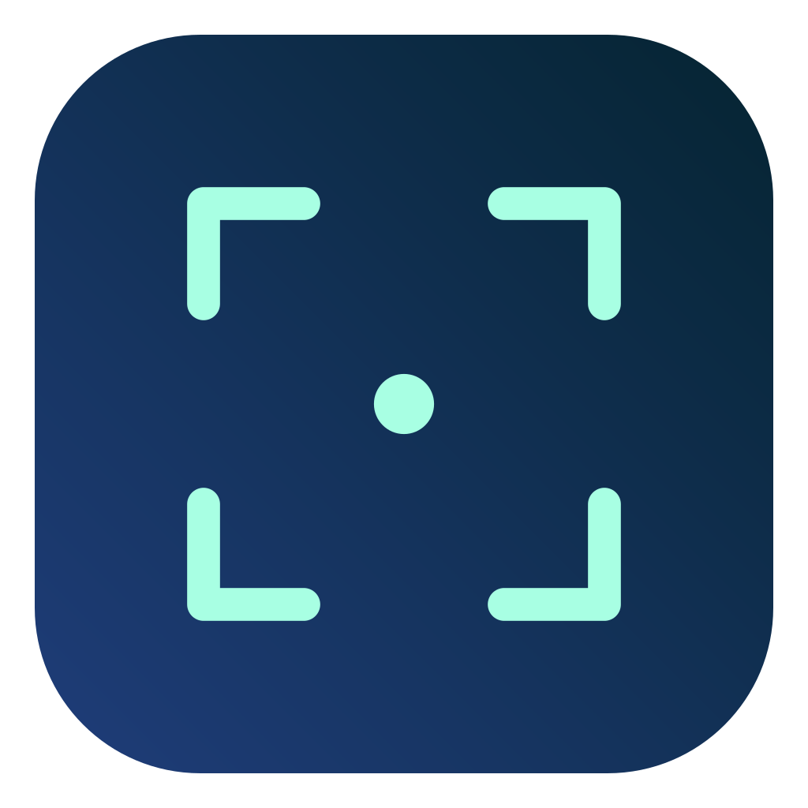
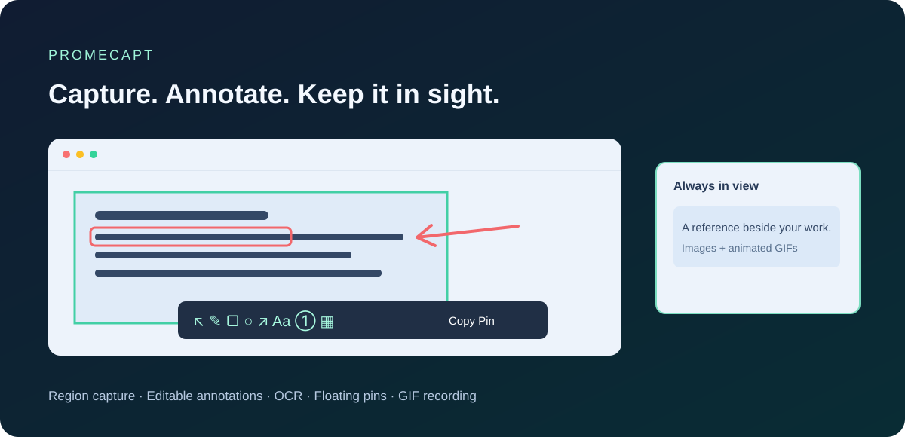

<div align="center">
  
  <h1>Promecapt</h1>
  <p><strong>截图，原位标注，随时贴在眼前。</strong></p>
  <p>商业截图工具的开源替代方案：macOS 截图、标注、贴图与 GIF 录制</p>
  <p><a href="README.md">English</a> · <a href="README.ko.md">한국어</a> · <a href="README.ja.md">日本語</a> · <a href="README.zh-CN.md">简体中文</a></p>
  <p><a href="https://github.com/PROMLEE/promecapt/releases">下载</a> · <a href="https://github.com/PROMLEE/promecapt/issues">反馈问题</a></p>
  <p>macOS 13 及以上 · Apple Silicon / Intel · MIT 许可证 · v1.0.0</p>
</div>



## 主要功能

- **原位截图与编辑：** 自动识别窗口及辅助功能元素，拖动选区，通过八个控制点或键盘调整大小与位置。
- **可再次选择的标注：** 画笔、荧光笔、图形、箭头、文字与序号。使用选择工具移动、缩放或更改样式。
- **统一遮挡工具：** 马赛克、模糊与黑块，可用滚轮或数字增减按钮调整粗细和强度。
- **图片与 GIF 贴图：** 置顶显示，支持缩放、透明度、分组、鼠标穿透及重启恢复。GIF 贴图保留动画。
- **区域 OCR：** 只选择需要识别的文字，查看、编辑并复制结果。目前支持韩语与英语识别。
- **截图历史：** 使用 `,` / `.` 切换历史，同时还原周围屏幕。
- **GIF 录制：** 标记录制区域，自定义帧率、分辨率、时长和指针，录制后预览、复制、贴图或保存。
- **四种界面语言：** 韩语、英语、日语、简体中文，支持跟随系统及手动选择。

## 安装

**无需付费 Apple Developer 账号，也能在其他 Mac 上自行构建并运行 Promecapt。** 可以选择以下方式：

1. **使用免费开发工具本地构建：** 安装 Command Line Tools，获取发行版源码，运行 `bash scripts/package.sh`，然后安装生成的 `.app`。参见下方构建步骤与[详细安装指南（英语）](docs/INSTALL.md)。
2. **下载预构建 ZIP：** 在 [Releases](https://github.com/PROMLEE/promecapt/releases) 中为 Apple Silicon 选择 **arm64**、为 Intel 选择 **x86_64**。解压后将 **Promecapt.app** 移至“应用程序”。

当前 ZIP 使用 ad-hoc 签名，**没有 Developer ID 签名或 Apple 公证**。这不代表只能在开发者自己的电脑运行，而是 macOS 可能阻止下载应用的首次打开。针对确认可信的文件，请按照 [Apple 的单个应用打开说明](https://support.apple.com/en-us/102445)操作。受组织管理的 Mac 仍可能有额外限制。

请在 **系统设置 → 隐私与安全性 → 屏幕录制**（新版 macOS 为 **屏幕与系统音频录制**）中允许 Promecapt，并根据提示重启应用。元素识别和更可靠的全局快捷键处理需要辅助功能权限。应用不录制音频，可从菜单栏的截图框图标开始操作。

## 快速上手

| 操作 | 默认快捷键 / 手势 |
| --- | --- |
| 截取区域或窗口 | `⌥⌘1`，然后拖动或点击自动识别的对象 |
| 复制截图 / 贴图 | `⌘C` / `⌘Enter` |
| 将剪贴板内容贴到屏幕 | `⌥⌘3` |
| 显示 / 隐藏全部贴图 | `⌥⌘4` |
| 上一条 / 下一条截图历史 | 截图时按 `,` / `.` |
| 取消截图 / 关闭贴图 | `Esc` |
| 打开设置 | 菜单栏图标 → 设置，或应用激活时按 `⌘,` |
| 调节粗细 / 遮挡强度 | 在图片上滚轮，或使用数字增减按钮 |
| 移动 / 缩放贴图 | 拖动 / 滚轮 |
| 调节透明度 | `Ctrl` + 滚轮 |
| 原位编辑静态贴图 | `Space`，已有标注使用选择工具修改 |
| 录制 GIF | 菜单中的区域录制，或截图工具栏的 GIF 按钮 |

在设置 → 快捷键中可选择 **F1 / F3 / F4** 预设，或设置自定义组合。媒体键模式下请使用 `Fn+F1`，也可在 macOS 中启用标准功能键。`Enter` 只确认文字输入，不会结束截图。在设置 → 常规中可选择语言及是否显示程序坞图标。

## GIF 设置与结果

设置 → GIF 支持 **5–30fps**、**长边 640 / 1280 / 1920px 或原始 Retina 像素**、**最长 15 / 30 / 60 秒**，并可选择是否录制指针。不会放大原始图像；静止画面的实际帧数可能较少。临时帧文件达到 256MiB 时也会停止录制。

录制时以红色虚线与外侧的浅色阴影标记区域，不阻挡鼠标操作。停止后可在结果窗口预览并选择 **复制、贴图、保存**。复制包含原始 GIF 数据、用于附件的文件路径及 PNG 备用图像，粘贴后的动画效果取决于接收应用是否支持 GIF。录制区域必须位于一个显示器内，不包含 Promecapt 自身窗口和音频。目前不支持 GIF 标注、旋转或逐帧编辑。

## 隐私与存储

图片及 OCR 均在本机处理。无需账号，不使用上传服务或分析数据收集功能。

历史记录会在本机保存所选图片、**当时的完整屏幕及选区位置**，以便恢复周围画面。截取敏感内容时请留意这一点。历史数量限制和清空历史会一并删除背景，贴图则单独保存。

设置与图片库保存在本机。复制 GIF 时使用本地附件缓存，并在新复制时清理较旧的缓存。

## 从源码构建

先运行 `xcode-select --install` 安装免费工具，安装完成后用 `swift --version` 确认 Swift 5.9 及以上。**无需付费 Apple Developer 账号、证书或签名密钥。** 仅 `swift test` 需要完整 Xcode，应用打包不需要。替换前请退出已有的 Promecapt。下面的命令安装到个人 Applications 文件夹，无需管理员权限。

```sh
git clone --branch v1.0.0 --depth 1 https://github.com/PROMLEE/promecapt.git
cd promecapt
bash scripts/package.sh
mkdir -p "$HOME/Applications"
ditto dist/Promecapt.app "$HOME/Applications/Promecapt.app"
open "$HOME/Applications/Promecapt.app"
```

CI 会在 Apple Silicon 和 Intel 上运行 XCTest。使用 `ARCH=arm64` 或 `ARCH=x86_64` 选择打包架构。另见[测试说明](docs/QA.md)、[发布流程](docs/RELEASING.md)、[更新记录](CHANGELOG.md)与[贡献指南](CONTRIBUTING.md)。

**1.0.0 尚未实现自动更新。** 后续计划加入 Developer ID 签名、公证与带签名的更新机制，方案见[自动更新设计](docs/AUTO-UPDATE.md)。

## 许可证

采用 [MIT 许可证](LICENSE)，在其条款下允许个人及商业使用、修改和再分发。应用图标与菜单栏图标由同一个自有截图框标记生成。

## 面向 LLM 的文档

[llms.txt](llms.txt) 提供文档索引，[llms-full.txt](llms-full.txt) 提供合并指南，[llm.txt](llm.txt) 为单数文件名的兼容入口。通过原始 Markdown 链接提供安装、使用、隐私与功能限制信息；不保证所有搜索引擎或 AI 会自动读取。
