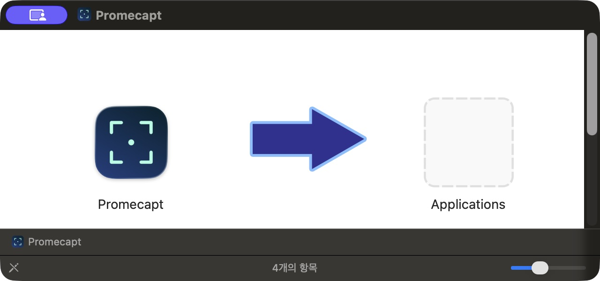
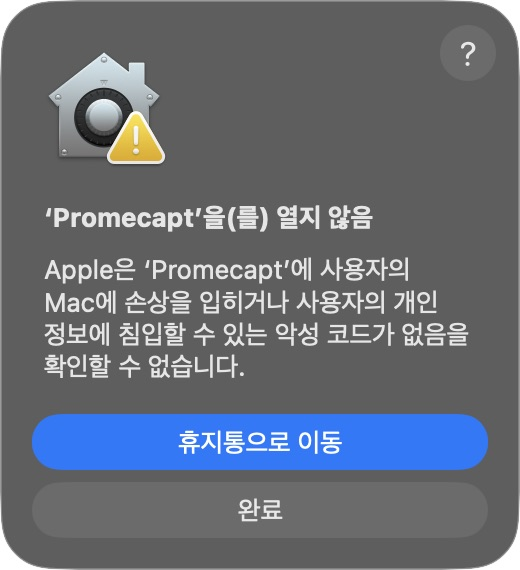
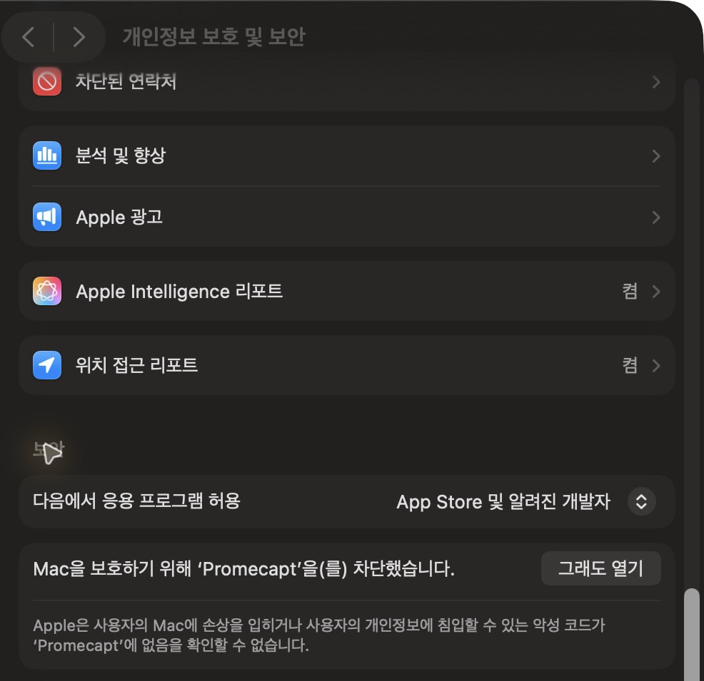

# Promecapt 설치

**일반 사용자는 방법 A의 DMG를 받으세요.** 터미널·개발 도구·유료 Apple Developer 계정이 필요 없습니다. macOS 13 이상을 지원합니다.

[English](INSTALL.md) · [다운로드](https://github.com/PROMLEE/promecapt/releases/latest)

## 방법 A — 배포판 설치 (권장)

### 1. 내 Mac에 맞는 DMG 받기

Apple 메뉴  → **이 Mac에 관하여**에서 칩/프로세서를 확인합니다.

| 표시된 칩/프로세서 | 받을 파일 |
| --- | --- |
| Apple M1·M2·M3·M4 등 | 이름이 `macos-arm64.dmg`로 끝나는 파일 |
| Intel | 이름이 `macos-x86_64.dmg`로 끝나는 파일 |

[최신 Releases](https://github.com/PROMLEE/promecapt/releases/latest)의 **Assets**에서 `.dmg`를 클릭합니다. `.sha256`, `appcast.xml`, Source code는 설치 파일이 아니므로 받을 필요가 없습니다.

### 2. 응용 프로그램 폴더로 설치

1. 기존 Promecapt가 실행 중이면 종료합니다.
2. 다운로드한 `.dmg`를 더블클릭합니다.
3. **Promecapt** 아이콘을 오른쪽 **Applications**로 드래그합니다. 기존 앱이 있으면 **대치**를 선택합니다.
4. Finder에서 Promecapt 디스크를 추출하고, **응용 프로그램 → Promecapt**를 실행합니다.



**ZIP을 받은 경우:** 더블클릭해 압축을 풀고 `Promecapt.app`을 Finder의 **응용 프로그램** 폴더로 직접 드래그한 뒤 실행하세요. **1.1.1부터** 응용 프로그램 폴더 밖에서 실행하면 **설치하고 실행**을 제안합니다. 1.1.0 ZIP에는 이 팝업이 없습니다. macOS 실행 차단은 아래 절차로 별도 허용해야 합니다.

### 3. ‘열지 않음’ 경고가 나오면

현재 공개 배포본은 Apple 공증을 받지 않았습니다. 신뢰하는 공식 다운로드에 아래 경고가 표시되는 경우에만 진행하세요.

1. **‘Promecapt’을(를) 열지 않음** 창에서 **완료**를 누릅니다. **휴지통으로 이동**은 누르지 않습니다.



2. ** → 시스템 설정 → 개인정보 보호 및 보안**을 열고, 오른쪽을 아래로 내려 **보안**을 찾습니다.
3. **‘Promecapt’을(를) 차단했습니다** 옆의 **그래도 열기(Open Anyway)**를 누릅니다.



4. 확인창에서 앱 이름이 **Promecapt**인지 확인하고 다시 **그래도 열기** 또는 **열기**를 누릅니다. Touch ID나 Mac 로그인 암호를 요구하면 시스템 창에서 인증합니다.
5. 이후에는 응용 프로그램 폴더의 Promecapt를 실행하면 됩니다. Dock에 없어도 메뉴 막대에서 실행 중일 수 있습니다. 앱을 다시 열면 설정 창이 나옵니다.

버튼이 없으면 응용 프로그램 폴더의 앱을 한 번 실행한 뒤 설정 화면을 다시 여세요. macOS 버전·언어에 따라 문구가 다를 수 있습니다. 회사 관리 Mac은 예외 허용이 제한될 수 있습니다. [Apple의 공식 실행 안내](https://support.apple.com/en-us/102445).

‘컴퓨터를 손상시킴’, 악성 코드, ‘손상된 앱’ 경고가 나오면 이 절차를 적용하지 말고 실행을 중단하세요.

### 4. 캡처 권한 허용

**‘그래도 열기’와 캡처 권한은 별도입니다.** 1.1.1부터 권한이 없으면 앱 시작 시 권한 안내가 열립니다. 앱의 **화면 캡처 허용…**, **손쉬운 사용 허용…** 버튼을 누르고 macOS 설정에서 Promecapt를 허용하세요. 메뉴 막대 → **권한 설정…**에서도 다시 열 수 있습니다.

1. 시스템 설정 → **개인정보 보호 및 보안 → 화면 및 시스템 오디오 녹음**에서 **Promecapt**를 켭니다. 구형 macOS에서는 **화면 녹화**입니다.
2. **손쉬운 사용**에서도 **Promecapt**를 켭니다. 버튼·입력칸 감지와 전역 단축키에 사용합니다.
3. 요청하면 앱을 종료한 뒤 다시 실행합니다. 메뉴 막대에서 영역 캡처를 선택합니다. 기본 단축키는 `⌥⌘1`이며 설정 → 단축키에서 변경할 수 있습니다.

스위치가 켜져 있는데 캡처가 거절된다면 앱을 종료하고, **Promecapt 항목만 제거 → + 버튼 → 응용 프로그램의 Promecapt.app 다시 추가 → 재실행** 순서로 갱신하세요. Touch ID 인증이 필요할 수 있습니다. 보관함을 삭제할 필요는 없습니다.

## 체크섬(SHA-256)은 꼭 확인해야 하나요?

**일반 설치의 필수 단계가 아닙니다.** 공식 Releases에서 맞는 `.dmg`를 받아 위 절차로 설치하면 됩니다. `.sha256`는 다운로드 파일이 배포 파일과 같은지 직접 확인하려는 사용자를 위한 선택 자료이며, 앱이 Apple 공증을 받았다는 의미는 아닙니다.

<details>
<summary>선택: 다운로드 무결성 확인 방법</summary>

1. 같은 이름의 `.dmg.sha256` 파일도 받습니다.
2. 터미널에서 다운로드 폴더로 이동한 뒤 아래 명령을 실행합니다. 파일명은 실제 받은 버전에 맞춥니다.

```sh
cd ~/Downloads
shasum -a 256 -c Promecapt-1.1.11-macos-arm64.dmg.sha256
```

`OK`면 일치합니다. `FAILED`면 설치하지 말고 공식 페이지에서 다시 받으세요. `No such file`이면 파일명·폴더를 확인하세요. Sparkle를 통한 앱 내 업데이트는 서명을 자동 검증하므로 사용자가 해시를 직접 비교하지 않습니다.

</details>

## 방법 B — 소스에서 직접 빌드 (개발자용)

Command Line Tools와 Swift 5.9 이상이 필요합니다. 유료 개발자 계정은 필요 없습니다.

```sh
xcode-select --install
```

설치를 마친 뒤 아래 명령을 실행합니다.

```sh
swift --version
git clone --branch v1.1.11 --depth 1 https://github.com/PROMLEE/promecapt.git
cd promecapt
bash scripts/package.sh
mkdir -p "$HOME/Applications"
ditto dist/Promecapt.app "$HOME/Applications/Promecapt.app"
open "$HOME/Applications/Promecapt.app"
```

Sparkle 의존성을 자동으로 다운로드합니다. 패키징에는 전체 Xcode가 필요 없으며 `swift test`에만 필요합니다. 빌드 후에도 위의 캡처·손쉬운 사용 권한을 허용하세요.

## 업데이트

1.1.0부터 **설정 → 정보 → 업데이트 확인** 또는 선택적 자동 다운로드·설치·재실행을 사용할 수 있습니다. 1.0.0 사용자는 새 배포본을 한 번 직접 설치해야 합니다. 1.1.2부터 공식 배포본은 고정된 자체 서명 인증서를 재사용합니다. 기존 임시 서명에서 전환하는 첫 업데이트는 캡처·손쉬운 사용 권한 재등록이 한 번 필요할 수 있으며, 이후에는 같은 서명 신원을 유지합니다. Apple 공증은 아니므로 ‘그래도 열기’가 필요할 수 있습니다. [서명 안내](CODE_SIGNING.md).
