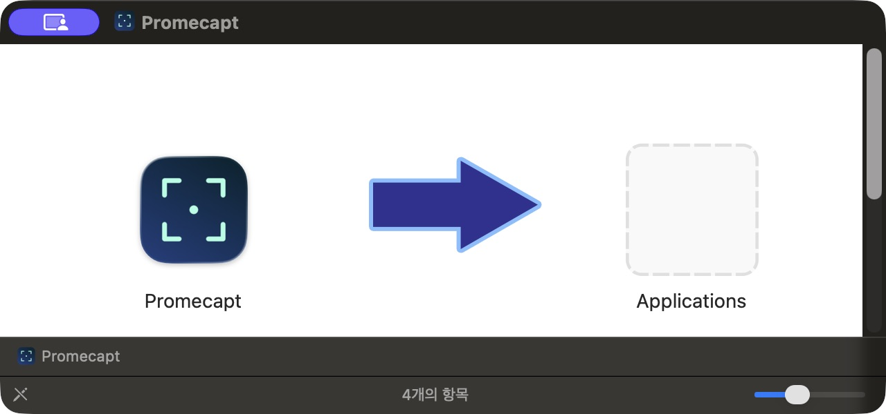
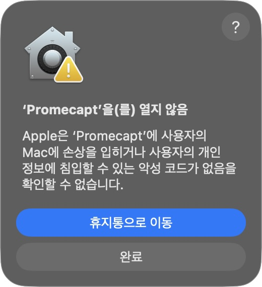
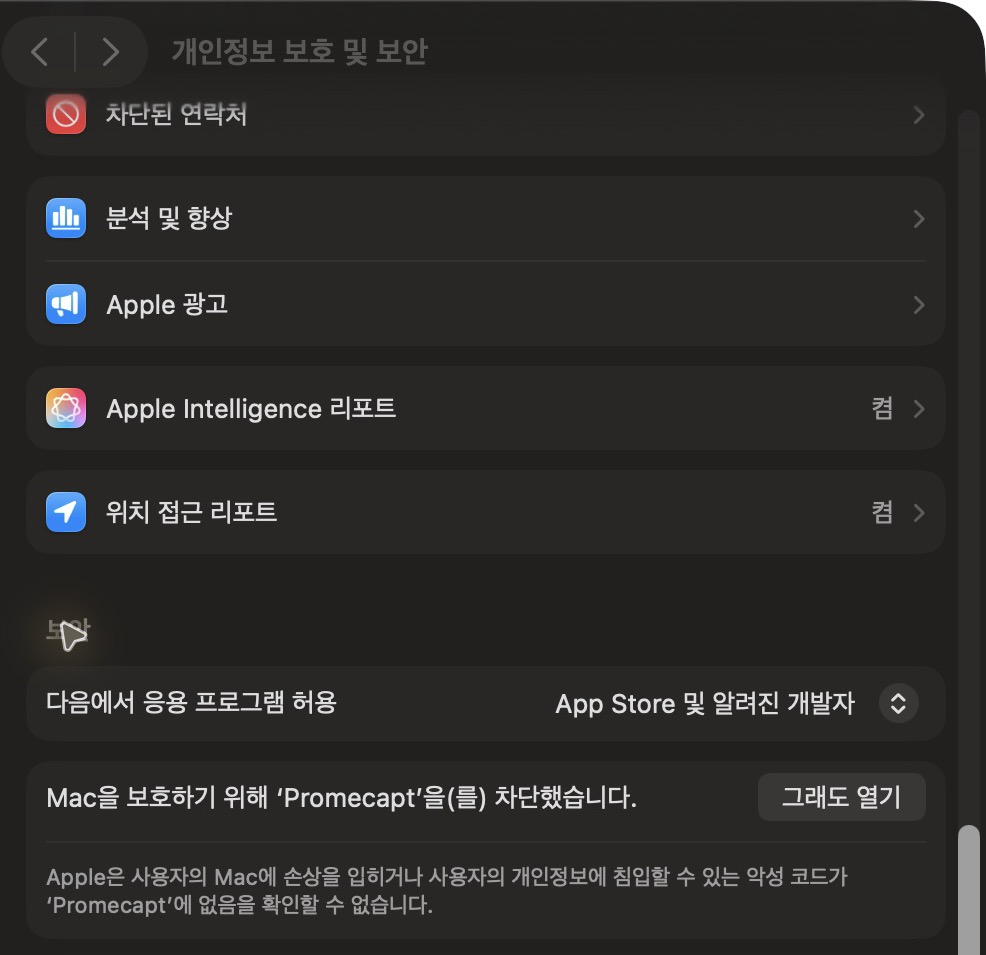

# Install Promecapt

**For normal use, choose Option A and download the DMG.** No Terminal, developer tools or paid Apple Developer account is needed. Requires macOS 13+.

[한국어](INSTALL.ko.md) · [Download](https://github.com/PROMLEE/promecapt/releases/latest)

## Option A — Install a release (recommended)

### 1. Choose your Mac

Open  → **About This Mac** and check the chip / processor.

| Mac | File to download |
| --- | --- |
| Apple M1, M2, M3, M4, etc. | Ends in `macos-arm64.dmg` |
| Intel | Ends in `macos-x86_64.dmg` |

On the [latest release](https://github.com/PROMLEE/promecapt/releases/latest), expand **Assets** and choose the `.dmg`. You do not need `.sha256`, appcast XML or Source code to install.

### 2. Install in Applications

1. Quit any existing Promecapt instance.
2. Double-click the downloaded DMG.
3. Drag **Promecapt** onto **Applications**. Choose **Replace** if an older app exists.
4. Eject the Promecapt disk in Finder, then open **Applications → Promecapt**.



**Downloaded a ZIP?** Double-click to extract it, then drag `Promecapt.app` into Finder’s **Applications** folder before opening it. **From 1.1.1**, launching outside Applications offers **Install and Open**. The 1.1.0 ZIP has no such prompt. macOS opening approval is a separate step below.

### 3. If macOS blocks opening

The current public app is not Apple-notarized. Follow these steps only for the exact official download you trust. The screenshots below show Korean macOS; the equivalent English button labels are provided here.

1. If macOS says it cannot check Promecapt for malicious software, click **Done**, not **Move to Trash**.



2. Open ** → System Settings → Privacy & Security**. Scroll down to **Security**.
3. Find the message naming **Promecapt** and click **Open Anyway**.



4. Confirm the app name in the next dialog and click **Open Anyway** or **Open** again. Authenticate with Touch ID or your Mac login password in the system dialog if requested.
5. Use the installed app from Applications afterward. It may run only in the menu bar; reopening the app displays Settings.

If the button is missing, try opening the installed app once, then reopen this settings page. Wording varies by macOS version and language; managed Macs may restrict exceptions. [Apple’s opening instructions](https://support.apple.com/en-us/102445).

If macOS says the app will damage your computer, contains malware or is damaged, stop instead of following this exception procedure.

### 4. Allow capture permissions

**Open Anyway and capture permissions are separate.** From 1.1.1, a startup guide shows missing permissions. Use its **Allow Screen Capture…** and **Allow Accessibility…** buttons, then allow Promecapt in macOS. Reopen it from the menu bar → **Permissions…**.

1. In **System Settings → Privacy & Security → Screen & System Audio Recording**, enable **Promecapt**. Older macOS calls this **Screen Recording**.
2. Enable Promecapt under **Accessibility** for internal app-element detection and enhanced global shortcuts.
3. Quit and reopen the app if requested. Choose region capture in the menu bar. The default shortcut is `⌥⌘1`; customize it in Settings → Shortcuts.

If capture is denied despite its switch being on: quit the app, remove **only Promecapt’s** entry, click **+**, add the exact app in Applications, then relaunch. Authentication may be required. Keep your capture library.

## Do I need to compare SHA-256?

**It is optional, not part of the normal installation flow.** Download the matching DMG from official Releases and follow the steps above. The `.sha256` file lets interested users check download integrity; it does not mean the app is Apple-notarized.

<details>
<summary>Optional: verify a downloaded file</summary>

Download the matching `.dmg.sha256` file too. In Terminal, run the following, changing the filename to match the release you downloaded:

```sh
cd ~/Downloads
shasum -a 256 -c Promecapt-1.1.4-macos-arm64.dmg.sha256
```

`OK` means a match. For `FAILED`, do not install; download again from official Releases. For `No such file`, check the filename and folder. In-app Sparkle updates verify their signatures automatically, with no manual hash comparison.

</details>

## Option B — Build from source (developers)

Install Apple Command Line Tools and use Swift 5.9 or newer. No paid developer account is required.

```sh
xcode-select --install
```

Finish Apple’s installer, then run:

```sh
swift --version
git clone --branch v1.1.4 --depth 1 https://github.com/PROMLEE/promecapt.git
cd promecapt
bash scripts/package.sh
mkdir -p "$HOME/Applications"
ditto dist/Promecapt.app "$HOME/Applications/Promecapt.app"
open "$HOME/Applications/Promecapt.app"
```

The build downloads the pinned Sparkle dependency. Full Xcode is needed for `swift test`, but not packaging. Allow capture and Accessibility permissions as above.

## Updates

From 1.1.0, use **Settings → About → Check for Updates**, or opt in to automatic download, installation and relaunch. Version 1.0.0 needs a one-time manual installation of a newer release. From 1.1.2, official releases reuse a persistent self-signed certificate. The first transition from an older ad-hoc build may require one final capture / Accessibility permission refresh; later releases keep the same identity. This is not Apple notarization: Open Anyway can still be required. See [code signing](CODE_SIGNING.md).
